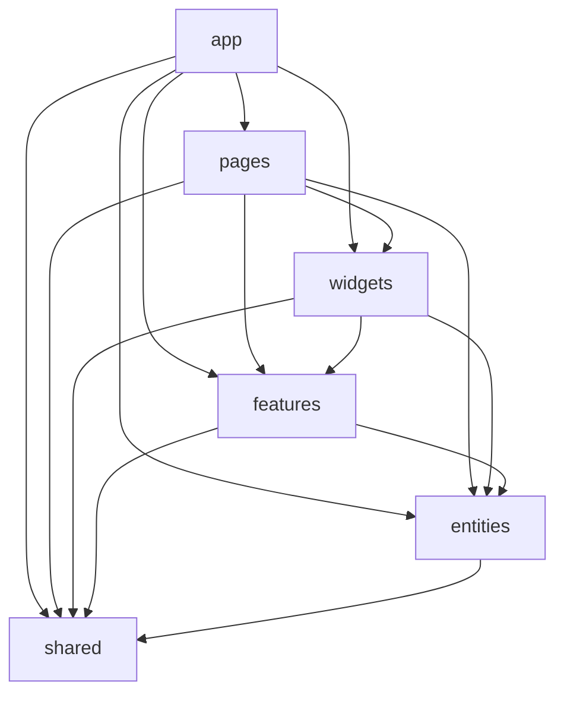

# Vue Lottery App

Навчальний застосунок Vue 3 + TypeScript: маршрутизація, авторизація та керування користувачами через DummyJSON. Архітектура організована за Feature-Sliced Design.

## Запуск

```sh
npm install
npm run dev
```

Production build і перевірки:

```sh
npm run build
npm run lint
npm run lint:fsd
```

Адреса API задається через `VITE_API_URL` у `.env`.

## Структура та залежності FSD

Кожен слайс експортує зовнішній API через `index.ts`. Імпорти між шарами спрямовані тільки вниз:



- `app` — запуск, провайдери, роутер, стилі та реєстрація сервісів.
- `pages` — компоненти маршрутів.
- `widgets` — складені блоки, як-от шапка і таблиця користувачів.
- `features` — дії користувача: авторизація, форми та пошук.
- `entities` — користувач, сесія та налаштування застосунку.
- `shared` — HTTP-клієнт, контракти Repository, реєстр сервісів та UI-обгортки.

Steiger перевіряє структуру FSD командою `npm run lint:fsd`. Для перехресних імпортів використовуйте публічний API слайса, наприклад `@/entities/user`, а не шлях до його внутрішніх файлів.

## Стан і збереження

Stores визначені через Pinia Setup Store та Composition API. Список користувачів і CRUD-дії зосереджені в `entities/user`; сесія — в `entities/session`; тема — в `entities/settings`.

Тема зберігається через `pinia-plugin-persistedstate`: плагін автоматично відновлює вибране значення і записує зміни. Сесія зберігається вручну в `session.store.ts`, оскільки HTTP-клієнту потрібно читати, оновлювати та видаляти токени під час авторизації й оновлення токена. Плагін зменшує шаблонний код для звичайного стану; ручне збереження дає явний контроль над окремими ключами та моментом їхнього оновлення.

## UI

Застосунок використовує PrimeVue з темою Aura та зеленим основним кольором. Компоненти бібліотеки імпортуються в `shared/ui`; решта коду використовує `AppButton`, `AppInput`, `AppTable`, `AppConfirmDialog` і `AppToast`. Окремі імпорти компонентів залишають можливість tree-shaking. Тему можна перемкнути в шапці; вибір зберігається в налаштуваннях Pinia.

Форми входу та користувача валідуться через VeeValidate. Поля показують помилки через `AppInput`; повідомлення про результати операцій з'являються через toast.
